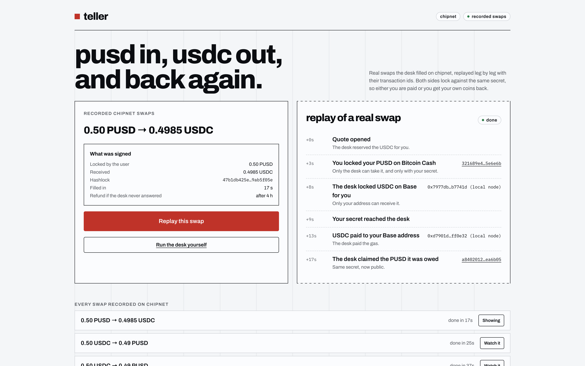
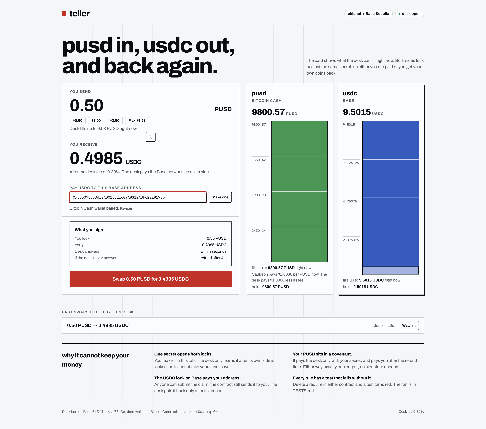
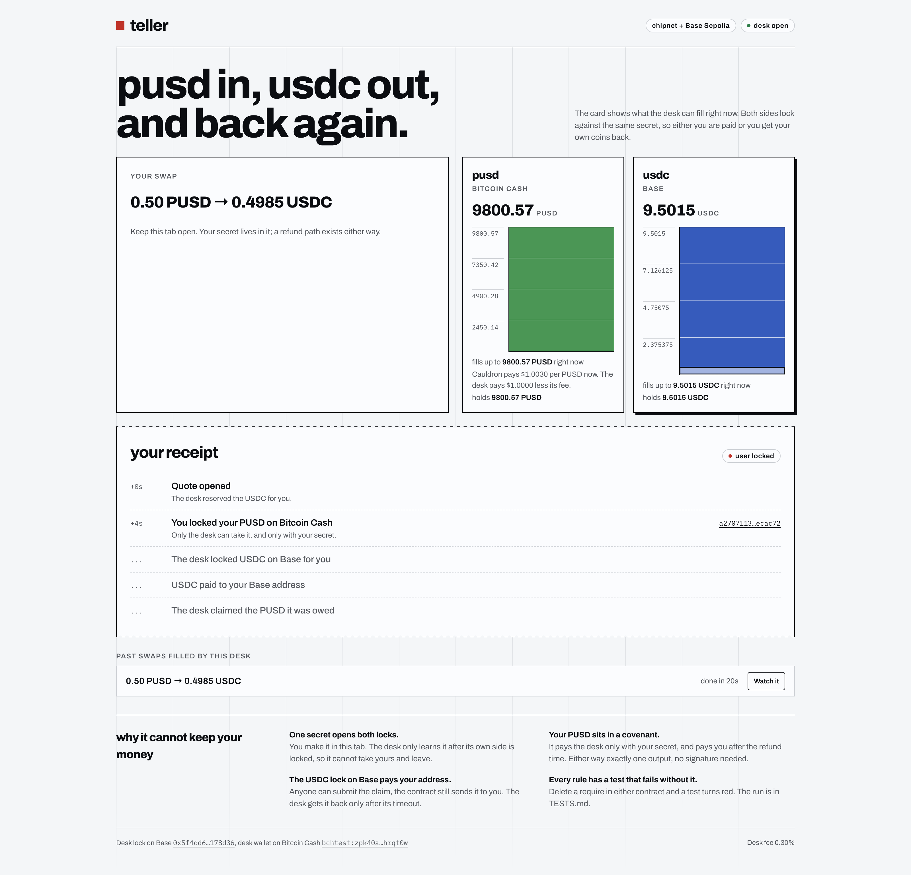
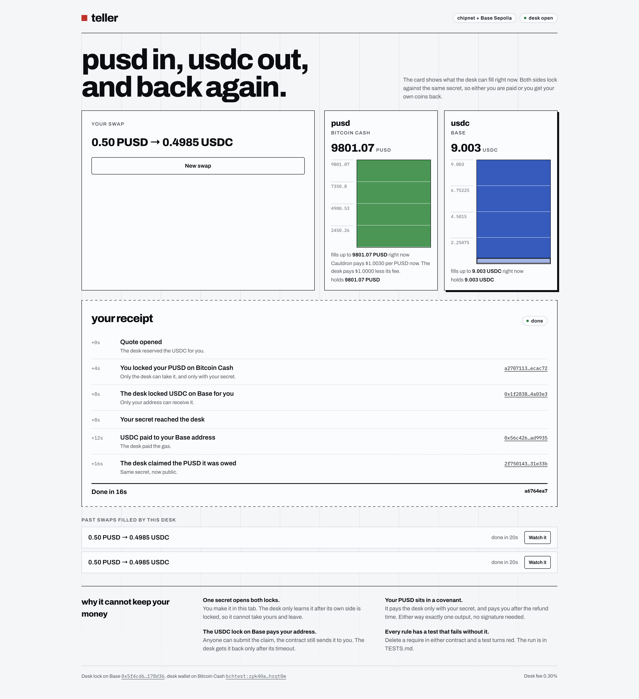
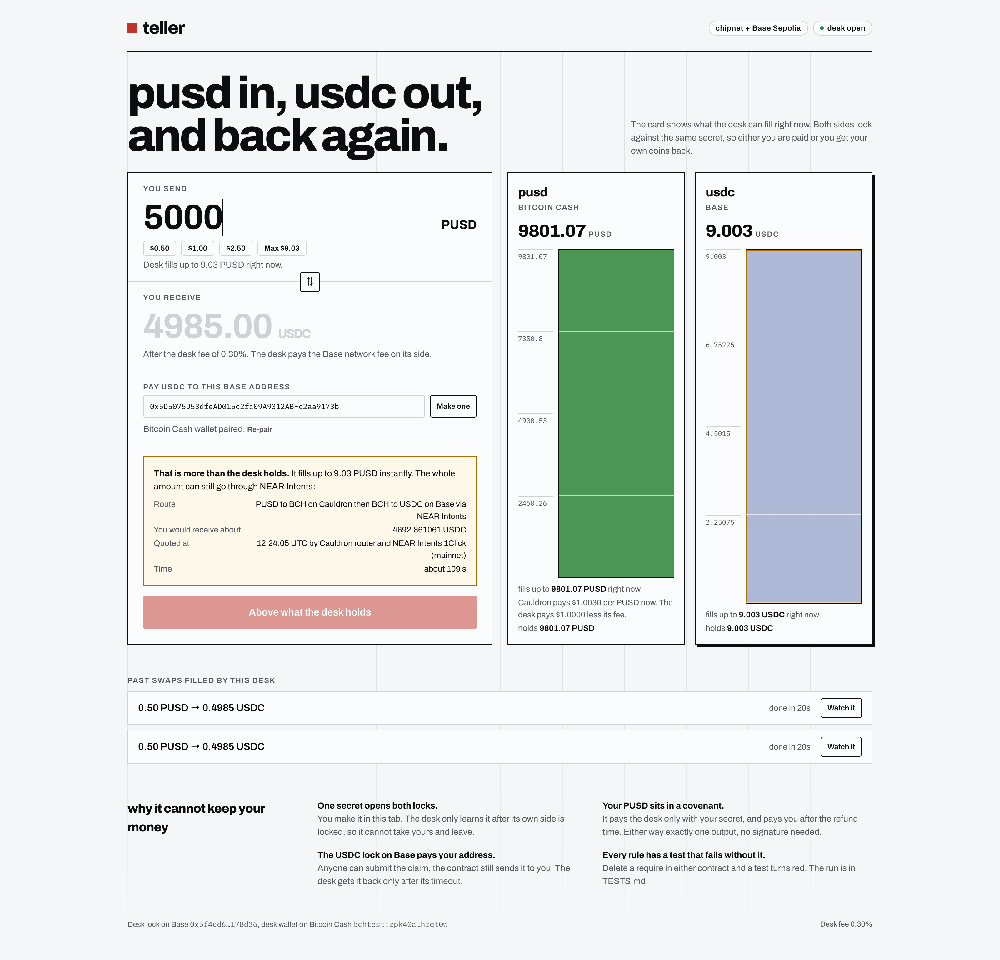
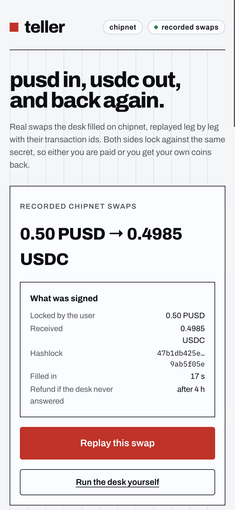
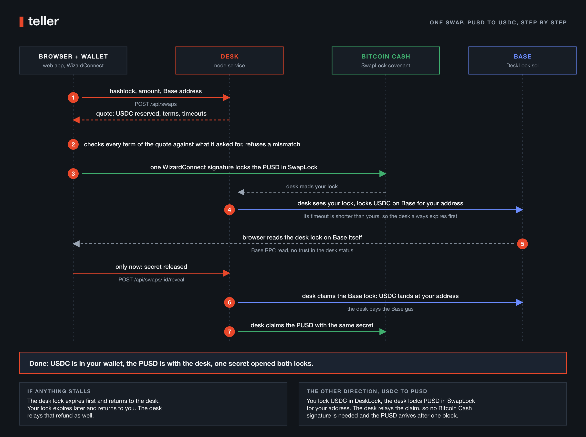
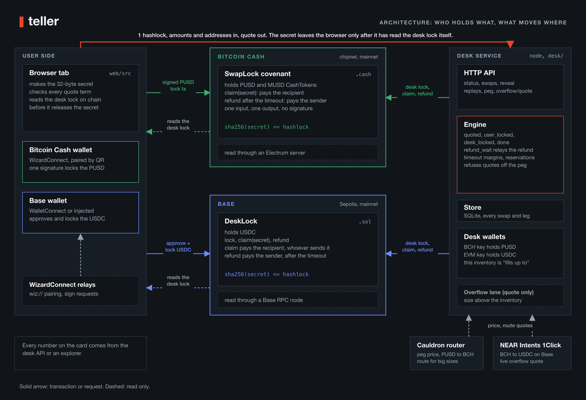

# Teller

**One secret opens two locks: PUSD and USDC swap atomically.**

Teller swaps ParyonUSD (PUSD) or MUSD on Bitcoin Cash for USDC on Base, and back, against a desk that holds inventory on both chains. The user's coins sit in a hash-timelock on one chain, the desk's coins sit in a hash-timelock on the other, and one 32-byte secret opens both; a size above the desk's inventory is quoted live through NEAR Intents and Cauldron, so no amount fails.

Bounty track: Stablecoin Bridge. PUSD and MUSD on Bitcoin Cash to USDC on Base, both directions, WizardConnect and WalletConnect, NEAR Intents above desk capacity.

## In the app

The card opens on a recorded 0.50 PUSD to USDC swap that replays leg by leg: user lock, desk lock on Base, secret, USDC paid, desk claim, each Bitcoin Cash leg linked to its chipnet transaction. Below it, the desk's other recorded swaps in both directions and a live NEAR Intents and Cauldron route quote read from your browser.

With a desk running, the same card shows two drawers, the PUSD drawer on Bitcoin Cash and the USDC drawer on Base, each with the live balance, what open quotes have reserved, and "fills up to" under the amount box. One WizardConnect signature locks the PUSD, and the receipt strip prints every leg with its elapsed seconds and an explorer link.

Above the desk's inventory, the card shows a live route quote instead of an error.

## How it works

PUSD to USDC. The browser makes the secret and sends the desk only its hash. One wallet signature locks the PUSD in the `SwapLock` covenant. The desk sees the lock and locks USDC on Base for the user's address with a shorter timeout. The browser reads that lock on Base itself, and only then releases the secret. The desk claims the USDC lock for the user, then claims the PUSD with the same secret.

USDC to PUSD runs the other way and needs no Bitcoin Cash signature: the desk relays the claim that pays the user, and the PUSD arrives after one block.

If anything stalls, the desk's lock expires first and returns to the desk, the user's lock expires later and returns to the user, and the desk relays that refund as well.

## Architecture

`SwapLock.cash` is a CashScript covenant over one CashTokens UTXO: claim needs the secret and pays exactly the recipient, refund opens after the timeout and pays exactly the sender, one input and one output either way, no signature checked. `DeskLock.sol` does the same for USDC on Base. The desk service (Node, SQLite) quotes, reserves inventory, locks, claims and relays refunds; the web app (React, Vite) pairs a Bitcoin Cash wallet over WizardConnect and a Base wallet over WalletConnect or an injected provider. Electrum and a Base RPC node are the reads. Cauldron supplies the PUSD price and the first leg of an overflow route, NEAR Intents 1Click the second.

## Proof

Every rule in both contracts has a mutant that deletes it, and the suite turns red. `TESTS.md` carries the full tables.

| Check | Result |
|---|---|
| Node suites (covenant 22, client 6, desk 20, security 20, wizard 2) | 70 tests, 70 pass, 0 fail |
| Forge suite, `DeskLock.t.sol` | 16 tests, 16 pass |
| Mutants killed | 100 of 100, 0 survived (15 covenant, 18 DeskLock, 67 desk engine and client) |

Recorded swaps on chipnet, Bitcoin Cash legs read back from the Electrum server, confirmations as of 2026-11-21T22:03Z.

| Direction | Leg | Txid | Confirmations |
|---|---|---|---|
| PUSD to USDC | user lock | [`321689e4d2...da5e6e6b`](https://chipnet.imaginary.cash/tx/321689e4d2bf425899d1dee908fe02b8a209a8fb00e9dbb073b0662cda5e6e6b) | 644 |
| PUSD to USDC | desk claim | [`a84020126a...7cea6b05`](https://chipnet.imaginary.cash/tx/a84020126aad146e637cc49195510eef785d2d80d60224b99ef7f38c7cea6b05) | 644 |
| USDC to PUSD | desk lock | [`3db3e99608...0232503a`](https://chipnet.imaginary.cash/tx/3db3e996082c2fb89db4e4dd6c124724e237fe4f3dc09067bb4791630232503a) | 753 |
| USDC to PUSD | user payout | [`c2843a8f47...5125f264`](https://chipnet.imaginary.cash/tx/c2843a8f47a58932ca72769fbb1bbf74a96841e79c10100e6a9fc53c5125f264) | 753 |
| USDC to PUSD | desk lock | [`733ae701ff...4b635aa0`](https://chipnet.imaginary.cash/tx/733ae701fffc41d68d688725abdabb31a777089c6f9c12eb7643cbc74b635aa0) | 783 |
| USDC to PUSD | user payout | [`54c8107326...215fea61`](https://chipnet.imaginary.cash/tx/54c8107326d644ca905666ed035f16016dceeb5c9c43e401c1c865e0215fea61) | 783 |
| PUSD to USDC | user lock | [`26764678d9...7a1873e5`](https://chipnet.imaginary.cash/tx/26764678d99cafcc749929b19a8b95b329625e19070f83713365169d7a1873e5) | 784 |
| PUSD to USDC | desk claim | [`40f467cbf6...c29fc1b1`](https://chipnet.imaginary.cash/tx/40f467cbf6e24a8d9869003a84b2c560e166fa1ef9b11bb5d4d85419c29fc1b1) | 783 |
| PUSD to USDC, user vanishes | BCH refund relayed to the user (30 units) | [`4e300792f2...375784d7`](https://chipnet.imaginary.cash/tx/4e300792f2855866e6345a235ff50b125dd7e354f5518b8643e71423375784d7) | 766 |
| USDC to PUSD, user vanishes | desk PUSD back after the refund time (29 units) | [`74545e7178...df9ecdff`](https://chipnet.imaginary.cash/tx/74545e7178835d49abff81a948913c566516357b766ce35f9ab16418df9ecdff) | 780 |

Both refund paths run live on chipnet: the user locks and does nothing, the desk takes its own side back, then relays the user's refund.

## What a judge can try in 60 seconds

1. Open [teller-bridge.vercel.app](https://teller-bridge.vercel.app). A real chipnet swap, 0.50 PUSD to 0.4985 USDC, replays leg by leg; press "Replay this swap" to run it again, or "Watch it" on any of the other five.
2. Click the Bitcoin Cash txid on the lock line and the claim line. The covenant lock and the desk's claim sit on chipnet for anyone to read, and the same secret opened both.
3. Scroll to the route panel. A large PUSD to USDC quote through Cauldron and NEAR Intents is fetched from your browser while you watch, and the [deck](https://teller-bridge.vercel.app/deck/) walks the same story in six slides.

## Built with

- Bitcoin Cash: CashScript 0.14 covenant, CashTokens (PUSD and MUSD), libauth, Electrum
- Wallets: WizardConnect (core, dapp, react) for Bitcoin Cash; WalletConnect and EIP-6963 injected wallets for Base, through wagmi and viem
- Base: Solidity `DeskLock`, built and tested with Foundry
- Overflow: NEAR Intents 1Click and the Cauldron router
- Desk service: Node.js with a SQLite store
- Web app: React 19 and Vite

## Links

- Live demo: https://teller-bridge.vercel.app
- Deck: https://teller-bridge.vercel.app/deck/
- Repo: https://github.com/passionate-dev7/teller-bridge
